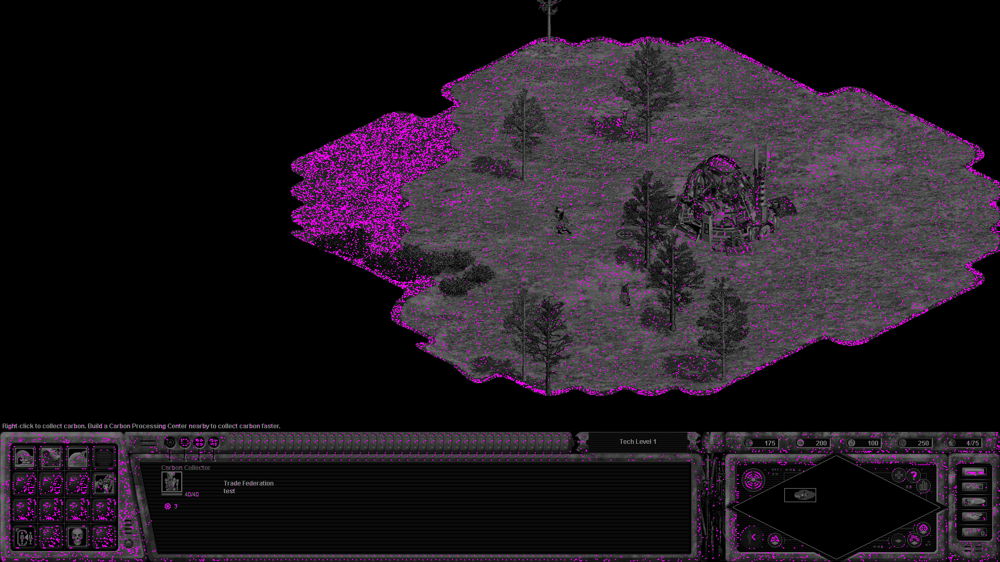
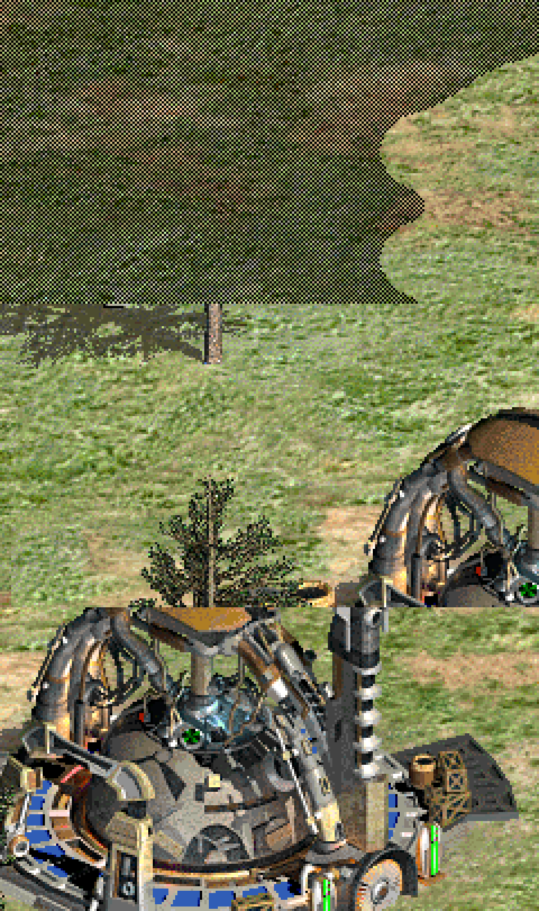

# Colour pipeline of Galactic Battlegrounds (Genie engine)

Findings from the Clone Campaigns 1.1 executable, its data files and indexed frame
dumps (`[Debug] DumpFrameSeconds=1` writes the engine's exact 8-bit frame and palette
to `Game\SWGBModern_frame.bmp`).

## 1. How sprites and palettes are decoded

- All graphics are **SLP** sprites: per-row run-length commands that write 8-bit
  palette indices. Special commands mark pixels as transparent (skip), **player colour**
  (an offset added to the owning player's base index), **shadow** and **outline**
  (shown in player colour when a unit is behind a building).
- There is **no true colour anywhere in the game**: everything is composed into an
  8-bit back buffer and shown with one 256-entry palette.
- Palettes are JASC `.pal` text resources in `INTERFAC.DRS` / `interfac_x1.drs`
  (34 of them, IDs 50500-50589 and 53016-53237).
- **In game, one palette is used for everything:** `INTERFAC.DRS` palette **50500**.
  The frame dump matched it in 256 of 256 entries. Each menu screen loads its own
  palette (the `palette_file` line of its `.sin` screen description), and the game
  switches palettes when changing screens.

## 2. Is palette reconstruction correct in SWGB Modern?

Yes.

- The game creates its palette with `DDPCAPS_8BIT | DDPCAPS_ALLOW256` (logged as
  `CreatePalette flags=00000044`). All 256 entries are the game's own; no Windows
  system colours are reserved.
- SWGB Modern stores `SetEntries` values unchanged (8 bits per channel). Each renderer
  maps index to colour in a shader from the same table.
- The renderer test compares each renderer's screen with the engine's own 8-bit frame
  (expanded through its palette). All six renderers are **pixel-exact** with the
  Nearest filter.
- So no colour noise or dithering is added between the engine's buffer and the screen.

## 3. Palettes for terrain, units, shadows, player colours and interface

| Element | Source of colour | Notes |
|---|---|---|
| Terrain | palette 50500 | 97x49 tile SLPs in `TERRAIN.DRS` / `terrain_x1.drs`. Hills are shaded by the engine (see 4b). |
| Units, buildings | palette 50500 | `GRAPHICS.DRS` / `graphics_x1.drs` |
| Player colours | ranges inside palette 50500 | player-colour pixels store an offset and the engine adds the player's base index |
| Unit and tree shadows | `Data\SHADOW.COL` | a 256-entry index remap: every colour maps to a darker palette colour. Smooth, **no dithering**. |
| In-game interface | palette 50500 | the panel art itself contains ordered dithering |
| Menus | one palette per screen (`.sin` `palette_file`) | |
| Fog of war, map edge | `Data\PatternMasks.dat`, `BlkEdge.Dat`, `TileEdge.Dat` and a stipple pattern | drawn as **black pixels in a checkerboard** |
| Terrain blending and lighting | `blendomatic.dat`, `lightMaps.dat`, `FilterMaps.dat`, `LoQMaps.dat`, `VIEW_ICM.DAT` | light and blend values are computed and mapped back to the nearest palette colour (`VIEW_ICM.DAT` is an inverse colour map, RGB to palette index) |

## 4. Where the visible noise comes from

Measured on a live frame (1920x1080): **3.2 %** of pixels lie in 2x2 checkerboard cells.
**51 %** of those cells pair palette index 0 (black) with a terrain colour.

| Artifact | Origin | Evidence |
|---|---|---|
| a. Fog of war and the explored-map edge look like a black-and-white mesh | **Engine.** The fog is a black stipple pattern drawn over the terrain. The routine at `0x651780` (the `THIS_COD` blitter section) loads the pattern registers `0x7a4060-0x7a407c`. | The top checkerboard pairs are all index 0 plus a terrain colour. EF's "Alternative Fog of War" hooks only this routine, which swaps the pattern. |
| b. Grain and speckle inside terrain | **Original art.** The textures were quantised to the 256-colour palette with dithering. Hills add a second quantisation through `VIEW_ICM.DAT`. | The original terrain SLPs already contain 0.4-7.5 % checkerboard cells (for example `TERRAIN.DRS` 15002: 7.5 %) |
| c. Dither in panels, buttons and menu backgrounds | **Original art** | Present in the interface SLPs |
| d. Unit and building sprites | **Original art**, mostly clean | Low checkerboard rate |
| e. Shadows | Engine lookup table, smooth | No dither found |
| f. DirectDraw palette conversion | **Not a source** in SWGB Modern | Pixel-exact test. (Windows' own 8-to-32-bit DirectDraw emulation can show wrong palettes after Alt+Tab, but it does not dither.) |

## 5. What can be improved without touching the original assets

All of these are optional and render-side. The default stays bit-exact.

1. **Smooth fog of war** (engine-generated pattern, so changing it is safe).
   - Option A, engine side: replace the fog stipple blit with a darkening pass through
     the game's own shadow remap (`SHADOW.COL`) or a 50 % palette blend table. The
     result is clean, even fog with no mesh. It needs reverse engineering of the
     `THIS_COD` fog blitter, the same area EF patches.
   - Option B, presenter side: detect the fixed-phase black checkerboard in the world
     view and replace each cell with the 50 % darkened colour of its non-black
     neighbours. This is easier, but it must exclude interface art that uses real black
     checkerboards, for example by limiting it to the world viewport.
2. **De-dither filter for ordered patterns (b, c).** This is palette-aware pattern
   detection, as in console emulators: blend only 2x2 checkerboards and 1-pixel stripes
   whose two colours are close in brightness. Real edges and outlines stay sharp. It
   runs on the GPU as a pre-pass before scaling, works in all renderers, and needs no
   asset changes.
3. **Edge-preserving smoothing for error-diffusion grain (b).** A small bilateral or
   guided filter with a strength setting. It softens grain on flat areas while keeping
   sprite edges, but it also softens fine original detail, so it should stay a
   preference with a strength slider.
4. **Leave as is:** shadows (already smooth); hill shading posterisation (fixing it
   would mean the mod rendering terrain itself); player colours.

The "palette-aware" part works because the filter sees indices, not only RGB. It can
always exclude index 0 (black outlines), the player-colour ranges and interface regions.
That keeps unit outlines, team colours and UI text unchanged while smoothing terrain
and fog.

## 6. Can the engine's palette be expanded (or the engine made true-colour)?

**About AoE2 DE.** SWGB runs on the Genie engine of *Age of Empires II: The Age of Kings*. AoE2 DE is not an upgraded Genie: it is a new engine with new 32-bit 4K art, so neither its code nor its art can be reused for SWGB. Anything "DE-like" for SWGB has to be built from SWGB's own engine and art.

**Why a bigger palette alone gives nothing.** Every sprite is stored as 8-bit palette indices (about 100,000 unit/building frames, 438 Mpx in `graphics*.drs`; 3,562 terrain frames; 8,811 interface frames). A 16-bit or 32-bit palette would map the same indices to the same colours. Colours that do not exist in the art cannot appear unless something *computes* new colours: fog, shadows, lighting and blending, or new art.

**What drawing involves.** All drawing happens in a small number of places:
- two C++ drawers: sprites (SLP) around `0x5430xx`, and terrain tiles around `0x60e000-0x60f4xx`;
- 11 hand-written assembly helpers in the `THIS_COD` section (48 KB), called from 59 sites: pattern setup, fills, blits;
- GDI text (already hooked for HD text).

The engine writes bytes directly into 8-bit surfaces. Those surfaces are ours (SWGB Modern emulates DirectDraw), but the writers assume one byte per pixel.

| Approach | What it means | Effort | Result |
|---|---|---|---|
| A. Convert the engine to 32-bit | Rewrite all the blitters and drawers for 4-byte pixels, plus the shadow/lighting/fog tables, minimap, palette effects and text | Very large (weeks of reverse engineering); high risk to stability and multiplayer sync | By itself, the same colours as now; only fog, shadows and lighting become smooth |
| B. 32-bit effects layer | Hook the fog, shadow and terrain-light drawing to record *how much* to darken or light each pixel in a side plane (like the HD text tags) instead of writing stipple or table colours; the presenter applies smooth RGB darkening | Medium | Smooth fog, shadows and hill lighting in true colour; engine logic untouched |
| C. HD sprite layer | Hook the sprite and terrain drawers to tag pixels with *sprite, frame, player, position* (the HD-text mechanism generalised). The presenter replaces tagged pixels with true-colour high-resolution versions made offline (AI upscale + de-dither, player colour from masks) | Large: engine hooks are medium, but the assets are big (about 100k frames; 4x upscale ~7 Gpx, likely 1-3 GB even compressed) | "DE-like" sharp true-colour units, buildings and terrain, while the engine stays 8-bit internally (multiplayer-safe) |

B is the realistic first step and matches the "optional, original stays default" requirement. It reuses the overlay and tag-plane code. C builds on B's hooks and can grow incrementally (for example terrain first, then buildings, then units) with downloadable packs.
